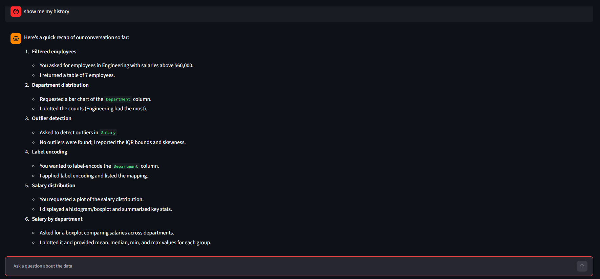

# 📊 CSV Analyst Agent

> Upload any CSV file and ask questions about it in plain English. An AI agent explores your data, cleans it for machine learning (outliers and encoding), draws graphs, and replies with the answer.

[](https://www.python.org/)
[](https://streamlit.io/)
[](https://www.langchain.com/)
[](https://groq.com/)

🔗 **Live Demo:** [https://csv-analyst-agent-89.streamlit.app/](#)


---

## 📸 Screenshots

<table>
  <tr>
    <th align="center">Upload a CSV and preview it</th>
    <th align="center">Ask questions in natural language</th>
  </tr>
  <tr>
    <td>
      
    </td>
    <td>
      
    </td>
    <td>
      
    </td>
  </tr>
</table>

---

## ✨ Features

- **Chat with your data:** ask questions like *"give me the mean salary of each department"* and get a formatted answer.
- **Agent with tools:** the LLM decides which tool to use (inspect, filter, analyze, clean, encode or plot) to answer each question.
- **Outlier detection and treatment:** find outliers with the IQR and z-score rules, then cap, replace or remove them in one message.
- **Categorical encoding:** label, one-hot, ordinal and frequency encoding, with the agent explaining which one fits your model.
- **Instant graphs:** histograms, boxplots, bar charts and a correlation heatmap appear right inside the chat, with the agent explaining what they show.
- **ML-ready export:** the preview always shows your *current* data, and a **Download processed CSV** button exports the cleaned version.
- **Undo anytime:** ask the agent to reset the data back to your original upload.
- **Conversation memory:** the agent remembers earlier messages, so you can ask follow-up questions like *"now plot it again"*.
- **Simple Streamlit UI:** no setup beyond uploading a file and typing a question.

---

## 🧠 How It Works

```
CSV upload ──► pandas DataFrame (kept in a shared store) ──► LangChain agent (Groq LLM)
                                                                    │
       ┌───────────────┬────────────────┬───────────────┬───────────┴───┐
       ▼               ▼                ▼               ▼               ▼
    Explore         Outliers         Encoding         Graphs          Utility
 get_data_info   detect_outliers    encode_data    plot_numerical    reset_data
 filter_rows     treat_outliers                    plot_categorical
 analyze_data                                      plot_correlation
                                                   plot_numeric_by_category
                                        │
                                        ▼
        Answer + graphs shown in the Streamlit chat, updated data shown in the preview
```

Tools that change the data (`treat_outliers`, `encode_data`, `reset_data`) update the working DataFrame, so each step builds on the previous one. Graph tools save an image that the UI displays under the agent's answer.

The agent is given eleven tools:

### 🔍 Explore

| Tool | What it does |
|---|---|
| `get_data_info` | Returns the shape, column names, data types, missing-value counts and first 5 rows of the uploaded CSV |
| `filter_rows` | Filters rows using a pandas query condition, e.g. `Salary > 60000 and Department == 'Engineering'` |
| `analyze_data` | Runs a pandas expression on the DataFrame, e.g. `df.groupby('Department')['Salary'].mean()` |

### 🚨 Outliers

| Tool | What it does |
|---|---|
| `detect_outliers` | Reports outliers per numeric column (IQR rule and z-score rule) plus skewness, **without** changing the data |
| `treat_outliers` | Fixes outliers with one of four methods: `cap` (clip to IQR bounds, keeps all rows, default), `median` (replace with the median), `remove_iqr` or `remove_zscore` (drop those rows) |

### 🔢 Encoding

| Tool | What it does |
|---|---|
| `encode_data` | Converts text columns to numbers using `label`, `onehot` (skips columns with more than 20 categories), `ordinal` (you give the order, e.g. `Low,Medium,High`) or `frequency` encoding |

### 📈 Graphs

| Tool | What it does |
|---|---|
| `plot_numerical` | Histogram with density curve plus boxplot for one column, or a histogram grid for all numeric columns |
| `plot_categorical` | Bar chart of category counts for one column, or a grid for all categorical columns |
| `plot_correlation` | Correlation heatmap of numeric columns, plus the strongest correlated pairs |
| `plot_numeric_by_category` | Boxplot of a numeric column split by the categories of another column |

### ♻️ Utility

| Tool | What it does |
|---|---|
| `reset_data` | Undoes all outlier treatment and encoding by restoring the original upload |

The agent is built with LangChain's `create_agent`, uses an `InMemorySaver` checkpointer for conversation memory, and runs the `openai/gpt-oss-20b` model through the Groq API. A system prompt guides it through a typical ML-prep order: inspect, detect outliers, treat outliers, then encode.

---

## 🛠️ Tech Stack

- **Language:** Python
- **UI:** Streamlit
- **Agent framework:** LangChain + LangGraph
- **LLM provider:** Groq (`langchain-groq`)
- **Data handling:** pandas, NumPy
- **Visualization:** Matplotlib, Seaborn
- **Deployment:** Streamlit Community Cloud, with code hosted on GitHub

---

## 🚀 Run It Yourself

This app uses the Groq API, so **you need your own free Groq API key** to use it. The code is open, so you can plug in your key and run your own copy.

### 1. Get a Groq API key
Create a free account at [console.groq.com](https://console.groq.com/) and generate an API key.

### 2. Clone the repository
```bash
git clone https://github.com/Ayush-kumar-jha953/CSV-ANALYST-AGENT.git
cd CSV-ANALYST-AGENT
```

### 3. Install dependencies
```bash
pip install -r requirements.txt
```
Make sure `requirements.txt` includes `matplotlib` and `seaborn` (used by the graph tools) alongside the existing packages.

### 4. Add your API key
Create a file named `.env` in the project folder:
```
GROQ_API_KEY=your_groq_api_key_here
```
> ⚠️ Never commit your `.env` file or share your key publicly. It is already listed in `.gitignore`.

### 5. Start the app
```bash
streamlit run app.py
```
Open the local URL shown in your terminal, upload a CSV (a sample file, `indianemployee.csv`, is included in this repo) and start asking questions. Generated graphs are saved in a `plots/` folder.

---

## ☁️ Deploy Your Own Copy on Streamlit Cloud

1. Fork this repository to your GitHub account.
2. Go to [share.streamlit.io](https://share.streamlit.io/) and sign in with GitHub.
3. Click **New app**, select your fork, and set the main file to `app.py`.
4. Open **Advanced settings → Secrets** and add:
   ```toml
   GROQ_API_KEY = "your_groq_api_key_here"
   ```
5. Click **Deploy**. Your own CSV analyst agent will be live in a minute or two.

---

## 💬 Example Questions

**Explore**
- "How many rows and columns does this file have?"
- "Give me the mean salary of each department."
- "Who are the employees in Engineering earning more than 70000?"
- "Which department has the highest total salary?"
- "Who joined most recently?"

**Clean for ML**
- "Detect outliers in all numeric columns."
- "Cap the outliers in Salary."
- "Label encode the Department column."
- "One-hot encode Department and Job_Title."
- "Prepare this dataset for a machine learning model."

**Visualize**
- "Show me the distribution of Salary."
- "Plot a bar chart of Department."
- "Show the correlation heatmap and tell me which features are most related."
- "Compare Salary across departments with a boxplot."

**Undo**
- "Reset the data to the original."

---

## 📁 Project Structure

```
CSV-ANALYST-AGENT/
├── app.py               # Agent, tools (explore, outliers, encoding, graphs) and Streamlit UI
├── indianemployee.csv   # Sample dataset to try the app
├── requirements.txt     # Python dependencies
├── plots/               # Generated graph images (created automatically at runtime)
├── .gitignore
└── README.md
```

---

## ⚠️ Limitations

- The `analyze_data` tool runs model-generated pandas expressions, so run this app only on data and in environments you trust.
- The working DataFrame is shared by everyone using the same running app instance, so concurrent visitors on a public deployment can overwrite each other's data. Run it locally, or deploy it privately, for reliable results.
- Conversation memory is kept in the running session only and resets when the app restarts or a new file is uploaded.
- Encoding "all categorical columns" will also pick up text columns like names and dates, which are usually not useful for ML. Name the columns you want encoded.
- Outlier detection treats every numeric column the same, including ID columns, so ignore results for identifiers.
- Graph grids are capped (12 numeric and 9 categorical columns per chart) to stay readable.
- Answer quality depends on the underlying LLM, so verify important numbers.

---

## 🔮 Future Improvements

- Missing-value imputation and feature scaling tools
- Date feature extraction (year, month, day of week)
- Support for Excel files and multiple CSVs
- Safer, sandboxed code execution
- Per-user data and conversation sessions
- Automatic train/test split and a baseline model

---

## 👤 Author

**Ayush Kumar Jha**
GitHub: [@Ayush-kumar-jha953](https://github.com/Ayush-kumar-jha953)
LinkedIn: [www.linkedin.com/in/ayush-jha-ds](#)

If you found this project useful, consider giving it a ⭐!
